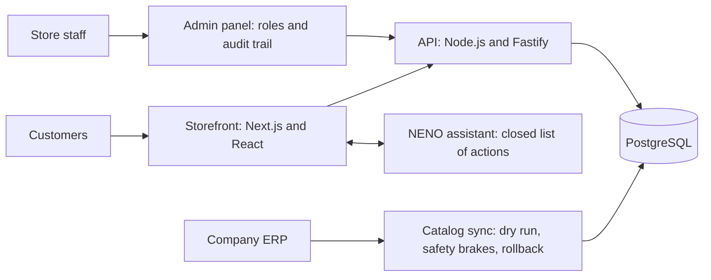

# La Universal online store: case study

> **Private code.** The source code belongs to the client and is not published. This repository is a case study: it describes the project at a high level, with no code, no screenshots and no internal details.

| | |
| --- | --- |
| **Client** | ACOSA |
| **Year** | 2026 |
| **Status** | In production |
| **Live** | [launiversal.com.ni](https://www.launiversal.com.ni) |

## Context

La Universal needed its own online store for its technology and home catalog, fed with the items, prices and stock of its ERP, plus an admin panel to run it.

## My role

Full-stack developer of the store: the storefront, the admin panel and the API behind them. NENO, the store's virtual assistant, is built by another team; the store integrates it.

## Architecture

- The storefront and the admin panel are a Next.js application on top of a custom API in Node.js (Fastify) and PostgreSQL.
- Search tolerates typos and offers suggestions.
- Amounts are always computed on the server.
- The catalog comes from the ERP through a sync that can be run as a simulation first and rolled back afterwards.
- NENO guides customers and can only run actions from a closed list. It never touches prices or confirms orders.

## Key features

- Search with suggestions and typo tolerance
- ERP sync with dry runs, safety brakes and rollback
- NENO assistant with a closed list of actions
- Bank transfer with receipt, or payment at pickup
- Coupons, campaigns and automated emails
- Role-based admin panel with audit trail

## Stack

Next.js · React · TypeScript · Tailwind CSS · Node.js · Fastify · PostgreSQL · Vitest · Playwright · Docker · AWS

## Results

In production and open to the public since October 2026, now at launiversal.com.ni, with the catalog synced from the ERP and more than 2,600 automated backend tests.
